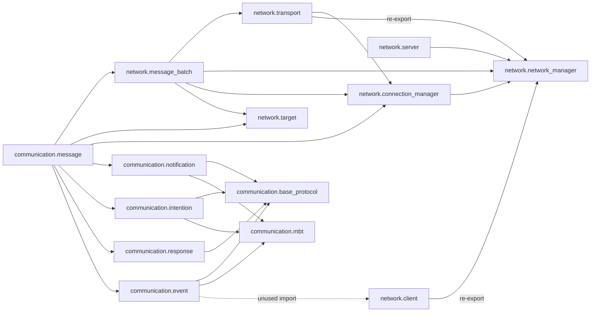

# C++17 header migration plan

Phase 1 audit, 2026-11-13. This document describes the verified baseline and the
proposed migration; no library implementation or build configuration has been
changed in this phase. Source references below are relative to the repository
root and refer to commit `541ae1d39225ec9b747b9f888f96242a710e9073`.

## 1. Baseline and scope

- Repository: <https://github.com/pietroth/LightnerX>.
- Remote default: `main`, verified with repository metadata and
  `git ls-remote --symref origin HEAD`. Fetched with
  `git fetch --no-recurse-submodules origin`; `origin/main` is the baseline above.
- Isolated branch: `refactor/cpp17-header-migration`, created from `origin/main`
  in `/tmp/LightnerX-cpp17-header-migration`.
- Original checkout: `/home/pietroth/Cpp/LightnerX`, still on `main`. Its existing
  GameNetworkingSockets edit is preserved. No reset, force-push, stash, merge, or
  modification of an existing branch was needed.
- All 40 tracked entries were inventoried: 14 `.cppm`, five test `.cpp`, four
  Python files, five CMake files, six Markdown files, four configuration files,
  one image, and one submodule gitlink. There are **no tracked first-party
  `.hpp`, `.h`, `.cc`, or `.cxx` files**, standalone example targets, or CI workflows.
  All first-party C++ and Python files were read, including embedded C++ in the
  Python fault tests and documentation examples.
- The ignored local `main.cpp` and `.zed/*.json` were also inspected, but are
  outside the committed baseline and will not be copied or changed by this plan.
  Generated/ignored build files are evidence, not migration inputs.
- No applicable `AGENTS.md` was found in the repository or its ancestor directories.

### Relevant history

The history contains 18 commits through the baseline. In particular:

| Commit | Architectural significance |
| --- | --- |
| `c245660` | Replaced ENet with GameNetworkingSockets. ENet is not a current dependency. |
| `5b656a2` | Added the GNS submodule. |
| `87f61c0` | Added `notification2OutboundMessage`; it exists in the current API. |
| `715727f` | Introduced `Target` and broadcast routing. |
| `faabbc1` | Added the `lightnerx` module and namespace prefixes. |
| `db97958` | Changed queuing to consume `OutboundMessage` directly. |
| `a52c046` | Fixed lifecycle, identity, framing, ownership, callback and exception defects; added regression tests. Tagged `v0.1.0-beta`; local `fix/audit-lx` also points here. Preserve these fixes. |
| `541ae1d` | Current default branch tip; README/logo change after the audit fixes. |

## 2. Verified file and interface inventory

Every module below imports `std`. A module's full name is `lightnerx.` followed
by its path with `/` replaced by `.` and `.cppm` removed. There are no partitions
or separate module implementation units. Class bodies and free-function
definitions currently live in the interface units.

### Communication modules

| Source (lines) | Exported interface | Direct first-party imports | Implementation and compatibility notes |
| --- | --- | --- | --- |
| `communication/base_protocol.cppm` (15) | `BaseProtocol(uint16_t)`, public `size` | None | Packed two-byte value; explicit `<cstdint>` replaces `import std`. Constructor remains non-`explicit`. |
| `communication/mbt.cppm` (14) | `MBT(uint16_t)`, public `type` | None | Packed two-byte value; same constructor constraint. |
| `communication/intention.cppm` (21) | `Intention(size, type, correlationId)`, public `protocol`, `mbt`, `correlationId` | `communication.base_protocol`, `communication.mbt` | Packed six-byte header. |
| `communication/event.cppm` (23) | `Event(size, typeId)`, public `protocol`, `mbt` | `communication.base_protocol`, `communication.mbt`, **`network.client`** | Packed four-byte header. Client import and network using-directive are unused by the type. |
| `communication/notification.cppm` (40) | `Notification(size, type)`; `NotificationRegistry::registerId(uint16_t)`, `registerIds(unordered_set<uint16_t>&&)`, `exist(uint16_t) const noexcept` | `communication.base_protocol`, `communication.mbt` | Packed four-byte header plus registry. Replace `contains`; retain C++17 node `merge`, including the source set's remaining duplicates. |
| `communication/response.cppm` (39) | `Response(size, correlationId, status)`; `UnsuccessfulResponse(size, correlationId, status, reasonCode)`; four response constants | `communication.base_protocol` | Packed five/seven-byte headers; constants are `uint8_t` values 0, 1, 2, 3. |
| `communication/message.cppm` (279) | `Message`; `MessageInterpreter`; five `*2OutboundMessage` converters | `network.message_batch`, `network.target`, `network.connection_manager`, `communication.notification`, `communication.intention`, `communication.response`, `communication.event` | Public span payloads and parameters. Private allocation helper calls GNS; parser copies fields with `memcpy`; callbacks are stored in deques. |

`Message::header` must retain variant order **Event, Intention, Response,
UnsuccessfulResponse, Notification**. `Message::payload` is a borrowed view.
`MessageInterpreter` exports registration functions taking
`function<void(Message)>` and `function<void(Message, uint16_t)>` by value,
`authorityInterpret(bytes)`, and
`obedientInterpret(bytes, const NotificationRegistry&, HSteamNetConnection,
const network::ConnectionManager&)`. Both interpretation functions return `void`.
The five converters are `event2OutboundMessage`, `intention2OutboundMessage`,
`response2OutboundMessage`, `unsuccessfulResponse2OutboundMessage`, and
`notification2OutboundMessage`; each takes its header by const reference, a byte
view by value, and `network::Target` by value, and returns `OutboundMessage`.

### Network modules

| Source (lines) | Exported interface | Direct first-party imports | Implementation and compatibility notes |
| --- | --- | --- | --- |
| `network/network_manager.cppm` (67) | `networkInit() -> bool`, `networkKill() -> void`, `isNetworkInitialized() -> bool`; `k_invalidConnection`; **`g_bNetworkInitialized`** | None | GNS init/kill, process-wide owner and cleanup hook. `detail` functions inside the exported namespace are also exported; see below. |
| `network/target.cppm` (43) | `Target::single(handle)`, `group(vector<handle>)`, `broadcast(vector<handle> = {})`; `isSingle/isGroup/isBroadcast() const noexcept` | None | Public `connection` variant ordered `monostate`, `vector<HSteamNetConnection>`, `HSteamNetConnection`; public `broadcastExceptions`. Private constructor; no public default constructor. Uses only C++17 features besides modules. |
| `network/connection_manager.cppm` (130) | `invalidConnection` (`int`, zero); `ConnectionManager(int initialReserve, int maxCapacity)`; copy/move operations; lookup/add/remove/count/iteration | `network.network_manager` | GNS validation on admission; private bidirectional mapping, free-ID set, 32-bit next ID. Replace map `contains` and abbreviated `forEach` template. |
| `network/transport.cppm` (94) | `sendToConnection(bytes, handle)`, `sendToConnections(bytes, const vector<handle>)`, `broadcast(bytes, const ConnectionManager&, const vector<handle>)` | `network.connection_manager`, **re-export** `network.network_manager` | All return `expected<void, error_code>`; vectors are passed **by value**, and direct broadcast has no default third argument. Replace spans, expected and `ranges::contains`. Reliable GNS sends. |
| `network/message_batch.cppm` (113) | `OutboundMessage { SteamNetworkingMessage_t* message; Target target; }`; `initMessagesBatcher(int)`, `clearMessagesBatcher() noexcept`, `queueMessage(OutboundMessage)`, `flushAll(const ConnectionManager&)` | `network.transport`, `network.network_manager`, `network.target`, `network.connection_manager` | Last two return expected. Non-exported `MessageQueue` and global `pending` own queued GNS allocations. Uses an internal span during flush. |
| `network/client.cppm` (281) | `Client`; callback registration; `start()`, `connect(string_view, int)`, `update(int)`, `disconnect(bool)`; `isConnected() const noexcept`, `getServerHConn() const noexcept` | **re-export** `network.network_manager` | Four operations return expected. Callback argument is `const function<void(byte_view)>&`. Deleted copy/move operations; destructor releases owner. Static callback instance and receive-batch guards. |
| `network/server.cppm` (292) | `Server`; three callback registrations; `start(int, uint32_t)`, `update()`, `disconnectConnection(handle, bool)`, `close() noexcept`; `k_invalidSocket`, `k_invalidPollGroup` | `network.network_manager` | First three operations return expected. Callback functions are passed by value. Deleted copy/move operations; destructor calls close. Deferred close, active-call guard, status-callback exception storage, static callback instance. |

`ConnectionManager` methods are
`getHSteamNetConnection(uint16_t) const noexcept`,
`getClientId(handle) const noexcept -> optional<uint16_t>`,
`add(handle) -> optional<uint16_t>`, `remove(int)`,
`getOnlineCount() const noexcept`, and `forEach(const auto&) const`.
Copy assignment has the strong exception guarantee. Defaulted moves are
nothrow, as asserted by `tests/connection_manager_assignment.cpp`.

Undocumented exported details matter: `network_manager.cppm:45` exports
`detail::setNetworkCleanup(void (*)() noexcept) noexcept`,
`detail::acquireNetworkOwner(const void*) -> expected<void, error_code>`, and
`detail::releaseNetworkOwner(const void*) noexcept`. A baseline import probe
confirmed these functions and `g_bNetworkInitialized` are accessible. Keep their
declarations in `network_manager.hpp`; move only their definitions/state to the
source file. Do not remove them merely because they are named `detail`.
`networkOwner`, `networkCleanup`, `MessageQueue`, `pending`, and
`communication::detail::allocateMessage` are not exported.

### Tests and other tracked files

| File | Verified purpose and migration action |
| --- | --- |
| `tests/connection_manager.cpp` (82 lines) | Real GNS socket pairs, absent IDs, duplicate admission, separate managers, userdata preservation, 70,000 recycling cycles, iteration mutation/exceptions. Replace imports/printing. |
| `tests/connection_manager_assignment.cpp` (149) | Thread-local allocation-failure sweep, copy strong guarantee, free IDs/capacity/mappings, nothrow move traits. Replace imports, spans, `ranges::find`, printing. |
| `tests/messages.cpp` (224) | All converters/statuses, framing/truncation/boundaries, unknown status/origin, callback mutation/state/exceptions, basic queue/flush/clear. Extra allocation/send faults under `LIGHTNERX_SOURCE_TEST`. Replace imports and spans, retaining that coverage. |
| `tests/lifecycle.cpp` (167) | Runtime ownership/reinitialization; wrapper traits; standalone server/client modes used by integration; reentrant callbacks, disconnect/reconnect, deferred close and status exceptions. Replace imports, spans and printing. |
| `tests/consumer/main.cpp` (13) | Independent target consumption, Steam include, shared invalid-handle constant, Client noncopyability/default state. Currently imports client and transport together. Convert to includes and extend to multiple translation units. |
| `tests/connection_manager_domain.py` (89) | Extracts actual manager body and supplies a fake GNS interface to exhaust 65,535 IDs. Hardcodes `.cppm`, `export namespace`, `-std=c++26`; fake also uses `contains`. Must adapt to header/source split. |
| `tests/message_faults.py` (84) | Concatenates production bodies, substitutes allocator and sends, and reuses `tests/messages.cpp`. Hardcoded ordered `.cppm` list, `<bits/stdc++.h>`, expected/span, `-std=c++26`. |
| `tests/lifecycle_faults.py` (223) | Extracts manager/client/server bodies, exposes private state in generated test code, injects receive/start failures, links real GNS. Uses `<bits/stdc++.h>`, `std::erase`, `-std=c++26`; optional `--baseline` reads `HEAD:*.cppm`. |
| `tests/integration.py` (31) | Chooses a local UDP port and runs server/client in separate processes with timeouts. Keep orchestration; update module terminology. |
| `CMakeLists.txt` (51) | Static target, global C++26, public `cxx_std_26`, experimental std-module gate, GNS integration, sanitizer option and optional tests. |
| `communication/CMakeLists.txt` (13) | Seven public `FILE_SET CXX_MODULES` entries. Replace with private ordinary source entries. |
| `network/CMakeLists.txt` (23) | Seven public module entries and an empty `NETWORK_SOURCES` variable. Replace with private ordinary source entries. |
| `tests/CMakeLists.txt` (72) | Four C++ executables, three Python fault/domain tests, UDP integration and separate consumer: **nine CTest tests**. Python required only with tests enabled; assertions forced on; bounded timeouts. |
| `tests/consumer/CMakeLists.txt` (15) | Independent parent project, CMake 4.2 and std-module gate before `project()`. Must consume headers by linking only `LightnerX`, without experimental parent setup. |
| `README.md` (454) | Architecture and complete server/client examples. Uses imports, span/as_bytes and println. Compile both complete examples after conversion. |
| `docs/api.md` (534) | Public signatures, error/ownership/reentrancy contracts. Update signatures precisely; retain documented behavior. |
| `docs/communication.md` (224) | INER wire representation, permissive response reception, Target/queue ownership and a broadcast example. |
| `docs/first-steps.md` (241) | Server/client/group-send examples; also uses C++20 `remove_cvref_t`. |
| `docs/setup.md` (101) | Current toolchain, dependency setup, parent std-module gate, sanitizer and UDP restrictions. Replace current setup with ordinary C++17 instructions at cutover. |
| `docs/audit-fixes.md` (141) | Historical evidence for LX-01 through LX-14. Its original eight-test report predates the assignment-test addition; do not mistake it for current suite size. Preserve history and add migration context if needed. |
| `.clangd`, `compile_flags.txt` | Force C++26; `.clangd` also strips module-related flags. Replace obsolete settings with C++17/compile-database support. |
| `.gitignore` | Build/module artifacts and local `/main.cpp` ignored. Keep useful historical artifact ignores; do not delete user files. |
| `.gitmodules` | Pins the GNS location/URL; leave it and the gitlink unchanged. |
| `docs/LightnerX Framed Wordmark.png` | Documentation asset; no migration change. |
| `external/GameNetworkingSockets` | Third-party gitlink, discussed below; not first-party source to convert. |

Local-only findings: ignored `/main.cpp` has 499 lines, old unprefixed module
names, `OutboundMessage::connection`, `queueMessage(bytes, handle)`, and
`flushAll()` without a manager. It incorrectly says the notification converter
does not exist, uses `bit_cast` (C++20), span and print (C++20/23), and runs
networking concurrently without the current synchronization contract. It is
not in CMake or the branch baseline. The ignored `.zed/settings.json` enables
experimental clangd modules; `.zed/tasks.json` and `debug.json` expect a
`build/LightnerX` executable that the committed library does not produce.
These local files are neither authoritative examples nor migration inputs.

## 3. Actual dependency graph

Arrows mean **importer depends on imported module**. All 14 nodes additionally
depend on `std`; Steam headers in global module fragments are shown separately
in the dependency discussion below. This graph is acyclic.



Communication is not currently independent of networking: the message adapter
uses GNS allocation, `Target`, `OutboundMessage`, and connection identity. Keep
that boundary for this migration. Conversely, network modules never import
communication. Remove the unused event-to-client edge when converting Event;
do not introduce a network-to-message dependency or a new cycle. A baseline
probe confirmed that importing Event alone does **not** expose
`lightnerx::communication::Client` on the verified GCC toolchain.

The cleanup hook creates a **runtime call relationship**, not a source cycle:
batch initialization installs `clearMessagesBatcher` in the runtime; shutdown
invokes it before GNS destruction. Keep the function-pointer hook so the runtime
source need not include or directly link to the batcher's implementation.

## 4. Dependencies and current build behavior

GNS is pinned to `d534c19aa760df3fb75fd20db13ba1932b8a5463`, tagged `v1.6.1`.
A clean copy was initialized in the migration worktree using the existing
checkout as a Git object reference; its sources are unchanged. Nested GNS
gitlinks are Abseil `c2435f8342c2d0ed8101cb43adfd605fdc52dca2`, vjson
`2533ddd055e2cd61d44a5e6b8743acb9a33bfd5c`, and WebRTC
`30a3e787948dd6cdd541773101d664b85eb332a6`. The default build succeeded without
initializing these optional nested dependencies. Do not enable optional tools,
tests or WebRTC just to perform the migration.

The pinned GNS CMake requires 3.15, advertises `cxx_std_17` publicly, uses
extensions and private `-fno-exceptions`/`-fno-rtti` flags. Its common target
helper sets C++11, but its public C++17 feature raises the effective standard:
the baseline compile database confirms **GNS uses `-std=gnu++17`** already.
Thus no GNS source downgrade is required. Protobuf-generated files remain
third-party/generated inputs.

Default dependencies are OpenSSL Crypto, Protobuf/runtime plus matching
`protoc`, Threads, and platform system libraries. This environment resolved
OpenSSL 3.5.5 and Protobuf 3.21.12. Optional crypto/WebRTC configurations have
not been validated by this audit. Newer Protobuf installations can introduce
additional requirements; keep the pinned GNS build's dependency resolution
instead of rewriting it.

`LightnerX` is `STATIC`, but publicly links **`GameNetworkingSockets`**, which
is the GNS **shared** target; GNS also builds `GameNetworkingSockets_s` by
default. A static LightnerX archive does not mean a fully static executable.
Preserve that link choice. Setting GNS `BUILD_SHARED_LIB=OFF` would remove the
target currently required by LightnerX and is not a supported migration shortcut.
Steam handles, messages and enums occur in public APIs, so GNS include paths,
definitions and link requirements must remain transitive.

There are no LightnerX install/export/package rules or executable entry point.
`add_subdirectory` plus `target_link_libraries(app PRIVATE LightnerX)` is the
current distribution contract. Packaging a new installed SDK is separate work.

## 5. C++20/23/26 compatibility audit

No first-party library construct requiring **C++26 specifically** was found.
C++26 is selected by build/editor/test flags; the actual newer constructs below
are C++20 or C++23. Removing module syntax alone is insufficient.

| Feature | Standard | Verified occurrences | C++17 treatment |
| --- | --- | --- | --- |
| Named modules, global module fragment, `export`, module imports | C++20 | All 14 library units; all five C++ tests import modules | Ordinary guarded public headers and privately compiled `.cpp` definitions. |
| Standard-library named module `import std` | C++23 | All 14 library units and five C++ tests, documentation | Explicit standard headers in every file; no dependency on transitive `std` visibility. |
| `std::span` | C++20 | `message.cppm:40,61,111,198,214,230,246,262`; `client.cppm:20,189`; `server.cppm:42`; `transport.cppm:16,49,70`; `message_batch.cppm:75`; assignment/messages/lifecycle tests; fault harness; docs | Stable C++17 span backport under a LightnerX compatibility namespace. Preserve borrowed storage, extent/count semantics and conversions. |
| `std::as_bytes` | C++20 | README lines 142, 243, 349, 423 | Companion backport helper or an explicit byte view; retain byte count rather than element count. |
| Associative `.contains` | C++20 | `notification.cppm:37`, `connection_manager.cppm:68`, domain-test fake at line 38 | `find(key) != end()`; no insertion or ownership change. |
| Abbreviated ordinary function template | C++20 | `connection_manager.cppm:117`, API documentation | `template<class Callback> void forEach(const Callback& callback) const`; body stays in header, exceptions still propagate. |
| `std::remove_cvref_t` | C++20 | `docs/first-steps.md:65,124` | `std::remove_cv_t<std::remove_reference_t<T>>`. |
| `std::ranges::find` | C++20 | `tests/connection_manager_assignment.cpp:61` | `std::find(begin, end, value)`. |
| `std::erase(vector, value)` | C++20 | `tests/lifecycle_faults.py:36` embedded C++ | Erase/remove idiom, removing every matching pointer. |
| `std::expected`, `std::unexpected` | C++23 | client/server/transport/batcher public results; runtime ownership helper; message fault mock; API/examples | Stable C++17 expected/unexpected backport; retain success/error state, exact `std::error_code`, bool/`has_value`/`error` and exception behavior. |
| `std::ranges::contains` | C++23 | `network/transport.cppm:77` | `std::find(exceptions.begin(), exceptions.end(), hConn) != exceptions.end()`. |
| `std::println` | C++23 | connection-manager, assignment and lifecycle tests; README/API/first-steps examples | `<iostream>` or `<cstdio>` output, preserving diagnostics. No formatting dependency needed. |
| C++26 flags/module machinery | Build configuration | Root CMake; both module file sets; consumer CMake; three Python compilers; `.clangd`; `compile_flags.txt`; setup docs | C++17 target requirements and ordinary compilation; eliminate experimental/module switches. |

The ignored local prototype adds `std::bit_cast` and `std::print`; neither is
used in tracked production code. There are no observed concepts/requires,
coroutines, ranges views, `jthread`, `consteval`, `constinit`, designated
initializers, or three-way comparisons in the tracked C++ implementation.

Retain C++17 facilities: `variant`/`monostate`/`visit`, `optional`, `byte`,
`string_view`, inline variables, `[[nodiscard]]`, `if constexpr`, init-statements,
nested namespace syntax, structured bindings, deduction of `std::array`, and
unordered-set node merge. Generic lambdas and `std::exchange` already work in
C++14. Do not replace these with weaker/custom equivalents.

## 6. Proposed header/source architecture

Keep namespaces `lightnerx::communication` and `lightnerx::network`, target name
`LightnerX`, and the existing source directories. Proposed public includes mirror
the module names, e.g. `#include <lightnerx/network/client.hpp>`.

```text
include/lightnerx/
  compat/
    span.hpp
    expected.hpp
  communication/
    base_protocol.hpp
    mbt.hpp
    intention.hpp
    event.hpp
    notification.hpp
    response.hpp
    message.hpp
  network/
    network_manager.hpp
    target.hpp
    connection_manager.hpp
    transport.hpp
    message_batch.hpp
    client.hpp
    server.hpp
communication/
  CMakeLists.txt
  notification.cpp
  message.cpp
network/
  CMakeLists.txt
  network_manager.cpp
  connection_manager.cpp
  transport.cpp
  message_batch.cpp
  client.cpp
  server.cpp
external/
  GameNetworkingSockets/       # same gitlink, unchanged upstream source
  span/                       # proposed pinned, unchanged backport + license
  expected/                   # proposed pinned, unchanged backport + license
tests/                        # existing coverage adapted to ordinary C++17
migration/                    # plan, state, and compatibility ledger
```

### Declaration and definition boundaries

| Public header | Header contents and includes | Source definitions / private dependencies |
| --- | --- | --- |
| `communication/base_protocol.hpp`, `mbt.hpp` | `<cstdint>`, packed value definitions and tiny constructors | No source needed. |
| `communication/intention.hpp`, `event.hpp` | Base/MBT headers, `<cstdint>`, packed definitions/constructors | No source needed. Event includes no client/network header. |
| `communication/response.hpp` | Base header, `<cstdint>`, both packed structs, constructors and constants | No source needed. |
| `communication/notification.hpp` | Base/MBT, `<cstdint>`, `<unordered_set>`; packed Notification; Registry declaration/storage | `notification.cpp` defines registry operations. |
| `network/target.hpp` | Steam types, `<variant>`, `<vector>`, `<utility>`; exact public fields and small factory/query definitions | No source needed; in-class definitions are inline. |
| `network/network_manager.hpp` | Steam types, compatibility expected, `<system_error>`; functions, exported detail declarations, `extern bool g_bNetworkInitialized`, one `inline constexpr k_invalidConnection` | `network_manager.cpp`: GNS init/kill include, all function definitions; one flag definition; private owner and cleanup pointer. |
| `network/connection_manager.hpp` | Steam types, `<cstdint>`, `<cstddef>`, `<vector>`, `<unordered_map>`, `<set>`, `<optional>`, `<limits>`; exact class storage; inline defaulted special members; full `forEach` template | `connection_manager.cpp`: ordinary methods and strong copy assignment; runtime header, GNS socket interface, `<algorithm>`, `<stdexcept>`, `<utility>`. |
| `network/transport.hpp` | Byte span, expected, `<cstddef>`, `<system_error>`, `<vector>`, Steam types; include runtime header to preserve its re-export; forward-declare ConnectionManager | `transport.cpp`: ConnectionManager, GNS sockets, `<algorithm>`, `<optional>`; reliable sends, first-error aggregation. |
| `network/message_batch.hpp` | Target, Steam message type, expected, `<system_error>`; complete OutboundMessage; function declarations; forward-declare ConnectionManager | `message_batch.cpp`: transport/runtime/manager, span, `<vector>`, `<utility>`, `<stdexcept>`; private queue, release guard and all batch operations. |
| `network/client.hpp` | Runtime header (preserves re-export), span/expected, Steam types and socket interface, `<cstddef>`, `<deque>`, `<functional>`, `<string_view>`, `<system_error>`; class fields and declarations | `client.cpp`: GNS interface, `<string>`, `<vector>`, `<utility>`; callbacks, methods, receive guards and one callback-instance definition. |
| `network/server.hpp` | Span/expected, Steam types and socket interface, `<cstddef>`, `<cstdint>`, `<deque>`, `<functional>`, `<exception>`, `<system_error>`; constants, fields and declarations including private ActiveCall | `server.cpp`: runtime/GNS interface, `<memory>`, `<utility>`; lifecycle, callbacks, guard definitions and one callback-instance definition. |
| `communication/message.hpp` | All INER value/registry headers, complete OutboundMessage/Target, span, `<variant>`, `<functional>`, `<deque>`, `<cstddef>`, `<cstdint>`; Message/Interpreter declarations; forward-declare ConnectionManager | `message.cpp`: manager and GNS utilities, `<cstring>`, `<limits>`, `<new>`, `<stdexcept>`, `<utility>`; parser, converters, private allocation helper and callback dispatch. |

Each public header must compile alone and include what its declarations and
inline/template bodies use. Each source includes its own header first. Use
qualified standard integer/size types rather than relying on `import std` or
incidental global typedefs. Do not manually redeclare GNS typedefs/structs;
include its public types header. Client/Server also need
`<steam/isteamnetworkingsockets.h>` to declare their interface-pointer members;
the types header alone does not declare `ISteamNetworkingSockets`.
Avoid namespace-wide using-directives in
headers. Add include guards and retain every `#pragma pack(push, 1)` / `pop`
boundary without leaking packing into the consumer.

Public non-template methods move out of line unless their small inline body is
needed by the stated design. No PIMPL or class-storage redesign is needed.
Preserve special-member availability and `noexcept` traits. Ordinary header
definitions of non-inline functions/globals would violate the one-definition
rule; use declarations plus exactly one source definition. The runtime flag,
queue, owner, cleanup hook and wrapper callback pointers must never become
per-translation-unit objects. Keep the queue's destructor/cleanup-unregistration
order and constant-initialized runtime pointers safe across translation units.

### Compatibility types

Use stable names `lightnerx::compat::span<T, Extent>`, `as_bytes`,
`expected<T, E>` and `unexpected<E>` through the two compatibility headers.
Do not add replacements to namespace `std`, or select a different public type
depending on the consumer's `__cplusplus`: a C++20/23 consumer must link against
the same public types as the C++17-built archive.

The proposed providers are the single-header
[tcb span backport](https://github.com/tcbrindle/span/blob/master/README.md) and
[tl expected backport](https://github.com/TartanLlama/expected/blob/master/README.md).
Their upstream documentation was inspected: tcb supports C++17 and deduction
guides; tl supplies expected/unexpected and documents an older expected proposal.
They are **candidates, not installed or validated dependencies** in Phase 1.
Phase 2 must pin immutable revisions, preserve their license files and upstream
contents, and verify the compatibility surface before adopting them. If a
provider cannot meet that surface, select a conforming backport rather than
silently narrowing the API. GNS is unaffected by this selection.

Use namespace using-declarations where suitable so original class-template
deduction guides remain available in C++17; **alias-template deduction is not a
C++17 feature**. Alternatively spell explicit template arguments at every call
site and document that requirement. Validation must cover empty/null views,
pointer/count, arrays/vectors, const conversions, `data`, `size`, `size_bytes`,
`empty`, iteration/indexing, `first`/`last`/`subspan`, `as_bytes`, and lifetime.
Expected validation must cover void success, unexpected construction, copy/move
and assignment, bool/`has_value`, `value`, and ref-qualified `error` access.
Inventory any differences in additional standard expected operations (especially
monadic names/semantics) before finalizing the public replacement. Never claim
that an older proposal implementation is a complete C++23 drop-in.

The unavoidable source-level spelling changes and provider decision gate are
tracked in [API_CHANGES.md](API_CHANGES.md). No wire-format change follows from
these compatibility types; neither is serialized into INER headers.

### CMake end state

- Continue `add_library(LightnerX STATIC)` and
  `target_link_libraries(LightnerX PUBLIC GameNetworkingSockets)`.
- Publish `target_compile_features(LightnerX PUBLIC cxx_std_17)`; require C++17
  and disable extensions on first-party targets. Do not propagate module flags
  or impose C++26 on a parent project. Verify actual compile commands and
  `__cplusplus` in a strict C++17 build; feature requirements alone are a minimum.
- Add the eight ordinary source files above as **PRIVATE** target sources.
  Publish `include/` and the chosen backports' include requirements; preserve
  transitive Steam definitions/link dependencies. Do not make consumer targets
  compile the library's `.cpp` files through public source lists.
- Remove `CMAKE_EXPERIMENTAL_CXX_IMPORT_STD`, `CMAKE_CXX_MODULE_STD`, target
  `CXX_MODULE_STD`, all `FILE_SET CXX_MODULES` and module scanning requirements
  from first-party CMake, including the independent consumer. No replacement
  experimental switch is needed.
- Proposed minimum CMake is **3.21**, to be verified in Phase 4; the GNS baseline
  requires 3.15 and 3.21 supports the intended JUnit validation workflow. Avoid
  adding newer header-file-set requirements. Local validation so far used 4.2.3.
- Keep `LIGHTNERX_BUILD_TESTS` off by default, Python conditional on tests,
  test assertions/timeouts, and `LIGHTNERX_SANITIZERS` public to instrument
  LightnerX plus consumers. Do not alter third-party compile options.
- Keep `BUILD_TESTS`/`BUILD_EXAMPLES` defaults for GNS as currently provided.
  Do not repurpose dependency cache options or switch the GNS link variant.
- A parent should need only `add_subdirectory` and `target_link_libraries`.
  Installing/exporting a new SDK, adding a framework/executable, and supporting
  a new fully-static GNS configuration are outside this migration.

## 7. Behavior and risk register

### INER wire contract

All integer bytes currently use **native machine representation** via `memcpy`;
there is no endian conversion or wire version field. Preserve this fact instead
of introducing network byte order. Packed layouts are:

| Type | Size / alignment | Fields and byte offsets |
| --- | --- | --- |
| BaseProtocol | 2 / 1 | `size: uint16_t @ 0` |
| MBT | 2 / 1 | `type: uint16_t @ 0` |
| Event, Notification | 4 / 1 | `protocol @ 0`, `mbt @ 2` |
| Intention | 6 / 1 | `protocol @ 0`, `mbt @ 2`, `correlationId: uint16_t @ 4` |
| Response | 5 / 1 | `protocol @ 0`, `correlationId: uint16_t @ 2`, `status: uint8_t @ 4` |
| UnsuccessfulResponse | 7 / 1 | Response field layout, `reasonCode: uint16_t @ 5` |

Authority Event/Response headers carry `(total_size << 1) | response_bit`, with
response bit 0/1 and maximum total 32767. Obedient Notification/Intention headers
carry the total directly, maximum 65535. Converters copy the **supplied** header
and payload; they do not encode, normalize, or validate the semantic size/status.
They guard allocation size against `int` overflow and throw `length_error` or
`bad_alloc` before returning ownership. The caller must initialize GNS first.

The parser accepts exactly one complete message, verifies decoded length against
the input view, checks the selected minimum header size, and silently rejects
invalid input. Registry membership distinguishes Notification from Intention;
Obedient delivery additionally requires a registered GNS handle. Unknown response
statuses produce no callback. Approved/failure responses **accept but ignore**
extra payload bytes when length is consistent; denied/partial responses expose
all bytes after the seven-byte header. A delivered `protocol.size` is decoded
and still counts ignored bytes. Do not tighten these rules during conversion.

### Ownership, routing and lifecycle

- The actual API is **`queueMessage(OutboundMessage)`**, where the object embeds
  a `Target`. There is no current `queueMessage(Target)` overload. Preserve
  single, explicit group, broadcast, and broadcast-with-exceptions factories.
  Group order/duplicates are retained; broadcasts resolve manager membership at
  **flush time**. Handles, internal client IDs and semantic type IDs are distinct.
- `OutboundMessage` remains a raw-pointer aggregate with its existing copy/move
  characteristics. Queuing consumes ownership on success and failure; a full
  queue releases the supplied message, and a null message gives `invalid_argument`.
  Do not add a destructor or make it move-only as part of the language migration.
- Reservation uses vector capacity, not a separate logical bound; initialization
  does not clear pending messages. Clear preserves capacity. Flush attempts all
  entries after returned errors, returns the **last** entry error and frees all
  messages. Group/broadcast sends attempt all recipients and return the **first**
  recipient error. Send exceptions release the remaining queue then propagate.
  Empty groups/broadcasts and an empty queue currently succeed.
- Received bytes remain valid only during the owning receive callback; copying
  `Message` copies the view, not its backing bytes. Converter input is copied into
  a distinct GNS allocation. Preserve these opposite ownership rules.
- Exactly one started Client or Server owns the global runtime. Start repetition
  gives `operation_in_progress`, a competing owner `device_or_resource_busy`.
  Network kill while owned is a no-op until owner release; preserve init retry,
  rollback, reconnect, invalid handles and explicit/manual runtime usage.
- Keep callback deques, registration-order dispatch and entry-time callback
  counts, mutable callable state, deferred server close, and receive RAII guards.
  Recursive update is rejected; callback exceptions propagate after cleanup;
  server status exceptions are captured at the GNS boundary and rethrown by
  update. Do not copy callback objects during dispatch or make forEach noexcept.
- Managers own independent mappings, leave GNS userdata alone and retain identity
  after transport closure until removal. IDs 1..65535 recycle; duplicate/invalid
  admission fails. Preserve bounded iteration with add/remove and the strong
  copy-assignment guarantee. `remove` may allocate in the free-ID set.
- Global queue/runtime operations remain externally synchronized. Thread safety,
  multiple concurrent wrapper owners, arbitrary non-GNS identity admission and
  destroying the object executing a callback are not newly supported features.

### Migration-specific risks and controls

| Risk | Control / acceptance evidence |
| --- | --- |
| Missing standard includes hidden by `import std` | Compile every public header alone, twice and in varied include order; compile complete examples. |
| Duplicate symbols or split global state after textual inclusion | One source definition per state/function; multiple-TU consumer checks shared flag, queue and invalid-handle constant. |
| Lost exported names, special-member or callback signature changes | Inventory above, preserve exported detail declarations, type/signature compile probes and assignment/lifecycle tests. |
| Different public types between C++17 and newer consumers | Fixed backport provider/configuration for all language modes; mixed-standard consumer links against the same archive. |
| Backport mismatch, alias-template CTAD or hidden owning conversions | Phase 2 compatibility gate; no namespace-std injection or borrowed-buffer-to-owning-container rewrite. |
| Packed layout/framing drift masked by round-trip tests | Explicit size/alignment/offset assertions and baseline byte fixtures, plus parser edge cases. |
| Globals and cleanup destructors reordered across source files | Preserve cleanup hook, queue release/unregistration order and stable runtime state; shutdown/exception and multi-TU tests. |
| Python fault tests silently stop testing production after files move | Adapt extraction to both headers and sources, include each definition once, retain injections and genuine production bodies; ordinary linked-library tests remain mandatory. |
| Nonportable test preambles/link flags | Replace `<bits/stdc++.h>` with explicit includes. Handle GNS shared-library/runtime paths through CMake for tested platforms; report platform limitations rather than silently skipping fault coverage. |
| GNS sanitizer incompatibility | Historical GCC 15 module/UBSan ICE should be rechecked after modules disappear. GNS still uses no RTTI: retain/report justified vptr exclusions at GNS boundaries, never claim untested full coverage. |
| Existing evidence confused with current results | Fresh baseline build below; historical `docs/audit-fixes.md` and original build trees are not substitutes. |

## 8. Exact migration sequence

Work from this baseline without rebasing/resetting another branch. Keep the
baseline build as a comparison artifact. Phase 1 ends with the three tracking
documents; the following are **pending implementation steps**.

### Phase 2: compatibility foundation

1. Pin and validate the C++17 span/expected providers and licenses. Implement only
   the stable compatibility headers; settle any extra API differences in
   `API_CHANGES.md` before converting public signatures. No source added to GNS.
2. Capture protocol layout/byte and API/ownership expectations using the baseline
   and existing tests. Add focused compatibility checks and future multi-TU
   consumer inputs where they validate the migration rather than duplicate code.
3. Establish the new include tree. Stage new headers/sources alongside the modules
   while the existing target still lists only modules. Use isolated C++17 compile
   probes for completed dependency closures. Never import the old modules and
   include replacement definitions in the same target/program.

### Phase 3: modules, in this exact topological order

This is valid for **every actual import edge**, including Event's unused Client
edge. Header-only cases have no artificial empty `.cpp` file.

| Step | Current module/file stem | New artifact(s) | Prerequisites already completed |
| --- | --- | --- | --- |
| 1 | `communication/base_protocol` | Matching public `.hpp` | Standard integer headers |
| 2 | `communication/mbt` | Matching public `.hpp` | Standard integer headers |
| 3 | `network/target` | Matching public `.hpp` | GNS types and C++17 variant/vector |
| 4 | `network/network_manager` | Matching public `.hpp` + `network/network_manager.cpp` | Compatibility expected, GNS |
| 5 | `communication/response` | Matching public `.hpp` | 1 |
| 6 | `communication/intention` | Matching public `.hpp` | 1, 2 |
| 7 | `communication/notification` | Matching public `.hpp` + `communication/notification.cpp` | 1, 2 |
| 8 | `network/client` | Matching public `.hpp` + `network/client.cpp` | 4, compatibility span/expected |
| 9 | `network/server` | Matching public `.hpp` + `network/server.cpp` | 4, compatibility span/expected |
| 10 | `communication/event` | Matching public `.hpp`; remove unused client dependency | 1, 2, 8 (current graph) |
| 11 | `network/connection_manager` | Matching public `.hpp` + `network/connection_manager.cpp` | 4; template body in header |
| 12 | `network/transport` | Matching public `.hpp` + `network/transport.cpp` | 4, 11, compatibility types |
| 13 | `network/message_batch` | Matching public `.hpp` + `network/message_batch.cpp` | 3, 4, 11, 12 |
| 14 | `communication/message` | Matching public `.hpp` + `communication/message.cpp` | 3, 5, 6, 7, 10, 11, 13 |

After each completed dependency closure, check the relevant C++17 headers and
ordinary object files independently. Preserve exact parameter passing/defaults,
visibility, constants, variant ordering and exceptions. Resolve any newly found
behavioral discrepancy in the ledger; do not bundle unrelated cleanup.

### Phase 4: build and consumer cutover

1. In one coherent integration change, replace both module source lists with
   ordinary private sources, expose public headers, set C++17 requirements and
   remove the experimental gates from root and consumer CMake. Only then remove
   the 14 obsolete `.cppm` files. Avoid a partially converted shipping target.
2. Convert test inputs in dependency order: connection-manager + assignment,
   domain harness; message tests + message fault harness; lifecycle + lifecycle
   fault harness; integration; independent consumer. The domain harness must read
   the manager declaration/template and out-of-line methods. The message harness
   must assemble value/registry/Target/queue/message definitions in dependency
   order. The lifecycle harness must assemble runtime and wrapper declarations
   and definitions. Keep injected calls/test-only private access out of the
   production API and prevent duplicated definitions/includes in generated code.
3. Change all three harness compiler invocations to C++17 and explicit standard
   includes. Replace their obsolete module parsing and `HEAD:*.cppm` baseline
   assumption; historical C++26 reproduction belongs to the recorded baseline,
   not the live C++17 test path. Preserve the meaning of each fault assertion.
4. Update `.clangd`, `compile_flags.txt`, README, setup/API/communication/first-steps
   examples and terminology. Keep the historical audit report identifiable as
   historical. Do not overwrite the ignored local prototype/editor settings.
5. Build and run the acceptance matrix below, fix migration regressions, update
   all tracking files with exact evidence and remaining limitations. Do not
   declare migration completion from compilation alone.

## 9. Acceptance criteria

### Phase 1 (this delivery)

- [x] Current remote default branch verified and fetched; requested branch/worktree created.
- [x] Original branch, dirty submodule and ignored local files preserved.
- [x] All tracked sources, tests, build files, examples/docs and relevant history inspected.
- [x] Actual dependency graph, exported interface, ownership and compatibility risks recorded.
- [x] C++17 header/source boundaries and dependency-respecting migration order specified.
- [x] Fresh original build and all nine baseline tests pass, with limitations stated.
- [x] `PLAN.md`, `STATE.md`, `API_CHANGES.md` created; implementation remains unchanged.

### Completed migration (future release gate)

- [ ] Clean GCC and Clang builds of the static library and all first-party tests
  in strict C++17; verify actual compilation flags and no module artifacts,
  imports, experimental gates or reliance on `<bits/stdc++.h>`. Validate proposed
  CMake 3.21 minimum as well as the current toolchain; record exact compiler and
  standard-library versions. Other OS/compiler support requires separate evidence.
- [ ] Every header is self-contained, include-order safe and packing-balanced;
  multiple TUs link without duplicate definitions and observe one runtime/queue.
  A C++17 parent and a newer-standard parent consume the same public type ABI
  through `target_link_libraries(... LightnerX)` with no experimental setup.
- [ ] All nine existing CTest cases retain their coverage and pass. Keep release
  assertions, allocation-failure sweeps, full ID-domain test, genuine GNS-linked
  tests, separate-process UDP integration and independent consumer build.
- [ ] Sizes, alignments, member offsets, response constants, variant ordering,
  and converter bytes match the baseline. Test all four semantic message kinds
  and all response statuses, both size limits, zero payload, extra response
  payload, malformed/truncated/concatenated messages and unknown origins/statuses.
- [ ] Additional routing coverage exercises **delivery**, not just Target query
  flags: single, multiple group recipients, empty group, broadcast, exclusions,
  duplicate handles, and membership changes between enqueue and flush.
- [ ] Preserve null/full queue errors, reserve-with-pending behavior, release
  counts on all error/exception/shutdown paths, first-vs-last error aggregation,
  empty operations and direct-send reliable flags. Existing tests cover only
  part of this matrix; add focused tests for the uncovered contracts.
- [ ] Callback lifetime/order/state, registration during dispatch, nested
  interpretation, recursive update rejection, deferred close, start rollback,
  repeated init/kill, competing owners, reconnect, manager copy guarantees and
  identity after transport close remain unchanged.
- [ ] ASan and supported UBSan checks pass on the conventional implementation;
  no recovery hides a diagnostic. Record any GNS/no-RTTI vptr exclusion separately
  from the removed module limitation. Third-party code/flags remain unchanged.
- [ ] Complete README server/client examples and first-steps/broadcast/group
  snippets compile in C++17 and agree with the public headers. All public API
  spelling changes are reflected in `API_CHANGES.md`; no undocumented behavioral
  or wire change is accepted.
- [ ] GNS gitlink unchanged; any new backport is immutable, licensed, reproducible
  and unmodified upstream code. No executable/framework or unrelated third-party
  rewrite introduced. Main and the original user's local work remain intact.

## 10. Baseline validation evidence

Fresh build in the isolated worktree, using GCC/libstdc++ 15.2.0, CMake 4.2.3,
Ninja 1.13.2, Python 3.14.4, OpenSSL 3.5.5 and Protobuf 3.21.12 on Linux x86_64:

```sh
cmake -S . -B build/phase1-baseline -G Ninja \
  -DCMAKE_BUILD_TYPE=Debug -DLIGHTNERX_BUILD_TESTS=ON
cmake --build build/phase1-baseline --parallel 2
ctest --test-dir build/phase1-baseline --output-on-failure \
  --output-junit test-results.xml -j 2
```

Configure and all 133 build steps succeeded. **9/9 CTest cases passed**, none
skipped, in 65.52 seconds. Tests ran with authorized local UDP access. Logs are
untracked under `build/phase1-baseline/`: `build.log`, `ctest.log`,
`test-results.xml`, `Testing/Temporary/LastTest.log`, and `compile_commands.json`.
The consumer test configured and built its own parent project. Two additional
compile-only probes confirmed exported runtime details and the lack of a
communication::Client re-export; `detail_exports.log` and `event_lookup.log`
record the expected success and expected name-lookup failure respectively.

This is a **C++26 baseline**, not a C++17 or sanitizer result. No Phase 1 sanitizer
rerun or Clang/Windows/macOS certification is claimed. Existing historical
sanitizer findings remain useful acceptance constraints. Current status and the
next implementation phase are recorded in [STATE.md](STATE.md).
